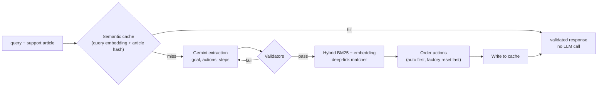

<div align="center">

# 🔧 TapFix

**Turns a Samsung support article into a validated, step-by-step fix, with one-tap deep links straight into the right Settings screen.**

[](https://www.python.org/)
[](https://fastapi.tiangolo.com/)
[](https://ai.google.dev/)
[](#-docker)
[](#-tests)

</div>

---

## 💡 The problem

Support articles are written for people to read: long, mixed with links and images, and they never take you to the setting they describe. An LLM can restructure them, but left alone it invents steps, leaks URLs and guesses deep links that don't exist.

TapFix keeps the model on a short leash: **the article is the only source of truth, every output is validated, and deep links come from a fixed catalog, never from the model.**

## ⚙️ How it works



| Stage | What it does |
|:---|:---|
| **Extraction** | Gemini turns the article into goals → actions → step groups (JSON). If validation fails, the errors go back to the model for a retry |
| **Validators** | Scrub URLs, markdown links and bare domains; enforce the goal, title, description and score rules. Anything that fails is retried, and nothing unvalidated is cached |
| **Deep-link matching** | BM25 + `all-MiniLM-L6-v2` embeddings (fused 0.4 / 0.6) over the Settings catalog, with a confidence floor, branded-feature checks and on/off polarity detection, so "turn **off** Wi-Fi" never maps to "turn on" |
| **Sequencing** | Deterministic order: automatic fixes → ordinary manual steps → disruptive ones (restart, safe mode) → critical (factory reset). Contradictory on/off toggles are resolved from the article |
| **Semantic cache** | SQLite cache keyed on the query embedding **and** a SHA-256 of the article, so paraphrased repeats skip the LLM but a changed article never serves a stale answer. Only validated responses are cached |

## 🔌 API

| Method | Path | Description |
|:---|:---|:---|
| `GET` | `/health` | Liveness check |
| `POST` | `/v1/troubleshoot` | Article + query → structured fix |

```jsonc
// POST /v1/troubleshoot
{
  "query": "My tablet screen goes blank when I open Gmail",
  "siis_response": { "title": "…article title…", "content": "…article text…" }
}
```

```jsonc
// 200 OK (illustrative, trimmed)
{
  "contexts": [{
    "goal": "Follow these steps to perform this Display Troubleshooting.",
    "title": "Fix Blank Screen",
    "actions": [{
      "actionName": "Turn off Adaptive brightness",
      "category": "auto",
      "stepGroups": [{
        "steps": ["Open Settings", "Tap Display", "Turn off Adaptive brightness"],
        "actionableDeeplink": { "deeplink": "…from the catalog…", "description": "…" }
      }]
    }],
    "score": 0.91
  }],
  "meta": { "cache_hit": false, "latency_ms": 2140.5 }
}
```

## 🚀 Quick start

```bash
git clone https://github.com/sudo-kk/tapfix-api.git
cd tapfix-api
pip install -r requirements.txt
cp .env.example .env        # then put your own GEMINI_API_KEY in .env
uvicorn app.main:app --reload
```

Open http://localhost:8000/docs for the interactive Swagger UI.

| Variable | Default | Purpose |
|:---|:---|:---|
| `GEMINI_API_KEY` | none | Required for extraction and paraphrase generation |
| `SEMANTIC_CACHE_THRESHOLD` | `0.82` | Cosine similarity needed for a cache hit |

## 🐳 Docker

```bash
docker build -t tapfix .
docker run -p 8000:8000 --env-file .env tapfix
```

The image installs CPU-only PyTorch and bakes in the MiniLM model, so it starts offline and stays small.

## 🧪 Tests

```bash
pytest tests/ -v
```

**112 tests** covering validators, deep-link matching against the real catalog, toggle-contradiction handling, action sequencing, fallback behaviour, parser fixes and the semantic cache (hits, misses, article-hash scoping). Gemini is mocked, so the suite runs offline with no API key.

## 📄 Data

Built for a Samsung troubleshooting hackathon. The deep-link catalog in `data/deeplinks.json` ships with **masked** URIs (`bixby://masked/...`) as provided, and `data/sample_output.json` is the reference output format. The organizer's 20 query/article pairs (`data/siis_responses.json`) and the generated `results.jsonl` are **not** published here: the benchmark scripts in `scripts/` expect them, and the one test that reads them skips when they're absent.

## 🗂️ Project layout

```
app/
  main.py             FastAPI app and request flow
  extraction.py       Gemini prompt, JSON parsing, retry-on-validation-failure, sequencing
  deeplink_match.py   hybrid BM25 + embedding matcher
  validators.py       URL scrubbing and output rules
  cache.py            SQLite semantic cache scoped by article hash
  enrichment.py       query paraphrases (used by scripts/generate_results.py)
  schema.py           Pydantic response models
scripts/              benchmark and results generation
tests/                pytest suite
```

---

<div align="center">
Built by <a href="https://github.com/sudo-kk">Karthik V K</a>
</div>
